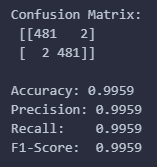

# 😷 Face Mask Detection System

The **Face Mask Detection System** is an AI-powered safety solution built with **Deep Learning** and **Computer Vision** to automatically check if people are wearing face masks. It helps monitor safety compliance in public areas, offices, or schools without needing manual human supervision.

Under the hood, the system uses a **MediaPipe** face detector to locate human faces in an image or video frame. Each detected face is then passed to a **MobileNetV2 CNN classifier** that checks whether the person is wearing a mask or not, and calculates a confidence score. It features both image upload and live webcam detection with an admin dashboard for analytics.

The project offers two simple interfaces to fit different needs: a **Flask web application** that runs in a browser and a **Tkinter desktop application** that runs offline on a local PC. Both interfaces use the exact same detection pipeline and save all of their results into the same SQLite database.

This project was built by **Muhammad Ismail** as a **Final Year Project (FYP)** for the **Virtual University of Pakistan** under the course code **CS619**.

---

## 🚀 Key Features

*   **💻 Dual Interfaces**: A responsive Flask web app for browser access, plus a native Tkinter desktop client for offline use.
*   **📸 Input Sources**: Accepts static image uploads or live webcam streams for mask detection.
*   **🔍 Face Detection**: MediaPipe locates multiple faces per frame at ranges up to 5 meters.
*   **🧠 Mask Classification**: MobileNetV2 CNN classifies each detected face as "Mask" or "No Mask".
*   **💾 ROI-Based Storage**: Stores only cropped face regions, not full frames, to reduce disk usage.
*   **⏳ Write Throttling**: Limits DB writes during live detection to one per 5 seconds, preventing log spam.
*   **🛡️ Admin Authentication**: Secure login gate restricts access to the admin dashboard.
*   **📈 Admin Analytics**: Charts and statistics to visualize detection data.

---

## 📂 Project Structure

```text
Face-Mask-Detection-System/
├── app/
│   ├── __init__.py              # Flask initialization
│   ├── blueprints/
│   │   ├── admin.py             # Admin portal routes
│   │   └── main.py              # Homepage & webcam routes
│   ├── models/
│   │   └── db.py                # SQLite Database models
│   ├── services/
│   │   ├── detector.py          # Detection pipeline (MediaPipe + CNN)
│   │   └── face_mask_detector_mobile-net-v2_model.keras  # Trained Keras model
│   ├── static/
│   │   ├── favicon.ico
│   │   └── uploads/             # Cropped face images
│   │       ├── mask/
│   │       └── no-mask/
│   └── templates/               # Flask templates
│       ├── base.html
│       ├── index.html
│       ├── login.html
│       ├── upload.html
│       ├── webcam.html
│       └── dashboard.html
├── instance/
│   └── detection.db             # SQLite database file
├── Documentation/               # FYP Documents (SRS, Design Doc, etc.)
├── test-images/
├── desktop_app.py               # Tkinter Desktop App (entry point)
├── run.py                       # Flask Web server runner (entry point)
├── Face_Mask_Detection_System_(MobileNetV2)_CNN_Model.ipynb  # MobileNetV2 CNN Model
├── requirements.txt
├── .env
├── .gitignore
├── assets/
└── README.md
```

---

## 🛠️ Tech Stack

| Component | Technology | Version |
| :--- | :--- | :--- |
| **Language** | Python | 3.12.x |
| **Web Framework** | Flask | 3.0.0 |
| **Desktop GUI** | Tkinter / PIL | Built-in / Pillow 10.2.0 |
| **Face Detection** | MediaPipe | 0.10.14 |
| **Image Classifier** | TensorFlow + Keras | 2.18.0 + 3.14.0 |
| **Image Processing** | OpenCV | 4.9.0.80 |
| **Database** | SQLite3 | Native |
| **Frontend Styling** | Tailwind CSS | v3 (via CDN) |
| **Analytics Charts** | Chart.js | via CDN |

---

## 📁 Dataset

The classification model was trained and evaluated using a custom dataset compiled and published by **Muhammad Ismail** on Kaggle:
👉 **[Kaggle: Face Mask Detection Dataset](https://www.kaggle.com/datasets/ismailfaridi/face-mask-detection)**

This dataset is a curated collection that combines image samples from various public sources. It has been consolidated, cleaned, and pre-processed into balanced face crops (with mask and without mask) designed specifically for training high-accuracy classification models.

---

## 📊 Model Training & Performance

The face mask classifier is built using transfer learning on **MobileNetV2** (pre-trained on ImageNet) and fine-tuned on the [Face Mask Detection Dataset](https://www.kaggle.com/datasets/ismailfaridi/face-mask-detection).

### 📈 Training Curves
Below is the training performance showing training and validation accuracy and loss trends over 10 epochs:


### 🧪 Evaluation Metrics
The model was evaluated on a test set of 966 samples (balanced with 483 mask and 483 no-mask samples), achieving outstanding classification results:



---

## ⚙️ Installation & Setup

```bash
# 1. Clone the repository
git clone https://github.com/ismailfaridi/Face-Mask-Detection-System.git
cd Face-Mask-Detection-System
 
# 2. Create and activate a virtual environment
python -m venv venv
venv\Scripts\activate          # Windows
source venv/bin/activate       # macOS / Linux
 
# 3. Install dependencies
pip install -r requirements.txt
```
 
Create a `.env` file in the root directory:
```env
# Flask configuration
SECRET_KEY=super_secret_key_123

# Database path
DB_NAME=instance/detection.db

# Admin credentials
DB_USER=admin
DB_PASSWORD=admin
```

---

## Trained Model

The trained MobileNetV2 model is not included in the repository because it exceeds GitHub's file size limit.

You can download the trained model from the **Releases** section of this repository. After downloading, place the `.keras` model file in the `app/services/` directory.

---

## ▶️ Running the Applications
 
### 🌐 Flask Web Application
```bash
python run.py
```
Open your browser at `http://127.0.0.1:5000`
 
| Route | Description |
| :--- | :--- |
| `/` | Homepage |
| `/upload` | Image upload & detection |
| `/webcam` | Live webcam stream |
| `/admin/login` | Admin login |
| `/admin/dashboard` | Admin analytics dashboard |
| `/admin/logout` | Admin logout |

> **Default Admin Credentials:**
> - **Username**: `admin`
> - **Password**: `admin`
 
### 💻 Tkinter Desktop Application
```bash
python desktop_app.py
```

---

## 🔍 Troubleshooting

- **ImportError: cannot import name 'mp.solutions.face_detection'**
  - **Reason**: Using an incompatible MediaPipe version.
  - **Fix**: Reinstall the exact version: `pip install mediapipe==0.10.14`.
- **Database file not found**
  - **Reason**: The directory or DB wasn't initialized.
  - **Fix**: Start the Flask web application once; it will automatically create the `instance` folder and database.
- **Model loading fails**
  - **Reason**: Missing Keras file.
  - **Fix**: Verify `face_mask_detector_mobile-net-v2_model.keras` is in the `app/services/` directory.

---

## 🎓 Project & Author Info

- **Project Type**: Final Year Project (FYP)
- **Institution**: Virtual University of Pakistan
- **Developer**: Muhammad Ismail
- **Website**: [ismailfaridi.com](https://ismailfaridi.com/)
- **Social Media**: [LinkedIn](https://www.linkedin.com/in/ismailfaridi/), [GitHub](https://github.com/ismailfaridi)